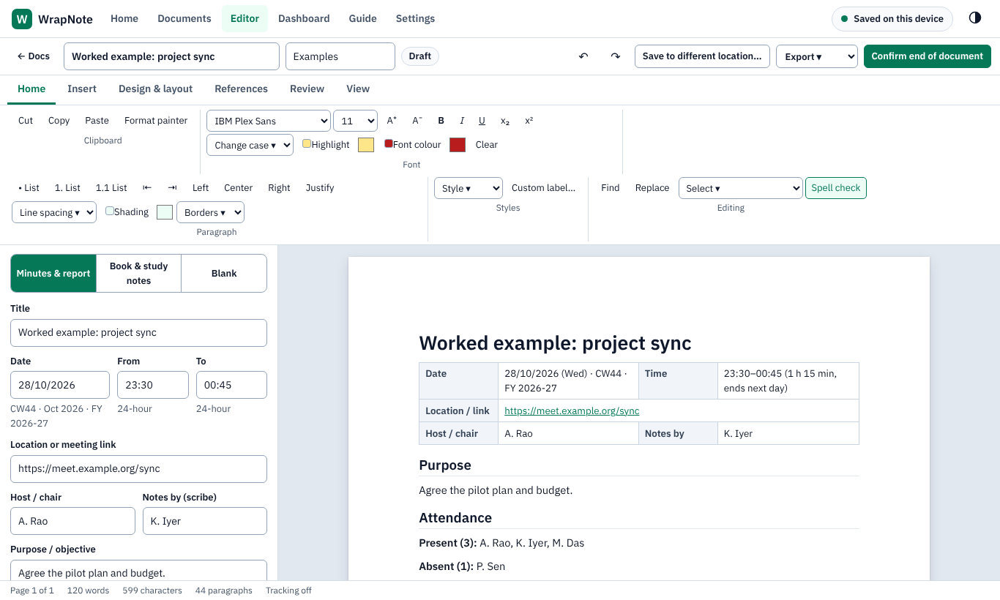

# WrapNote

**Never start from a blank page again.**

WrapNote is a browser app for live minutes of meeting, formal reports and study notes. You fill in a few guided fields on the left. A paged, Word-style document builds itself on the right. Every word saves as you type. It works offline, installs like an app, and keeps your documents on your own devices.

**Live app:** https://sathyanarayanan-2001.github.io/wrapnote/

## Features

- **Guided intake.** Minutes and report mode (date, times, people, agenda, decisions, action items with owner, due date and status, next meeting). Book and study mode (thesis, concepts, quotes with pages, mind map, active-recall questions, takeaways).
- **Content blocks.** Text with labels and callouts, smart tables, pictures and screenshots. Pictures sit in a grid, side by side, or stacked, and are never cropped. A screenshot taken later fills the next empty slot of a 2×2 grid. Reorder, arrange, format or delete blocks from a list.
- **Office documents.** A brand-neutral controlled-document template: classification and control table in the header with Page X / Y, a different first-page footer, cover page, revision history, contents and ten numbered sections. Import your own Word template instead: it is checked and cleaned on your device first.
- **Real Word files.** Export to .docx with Word styles, heading numbering, lists, bordered tables with repeating header rows, pictures, charts, equations, captions, contents and table of figures, footnotes, comments, tracked changes, page colour, borders and watermark.
- **Spell check as you type.** A British English dictionary on your device underlines a word as soon as you finish it; right-click for suggestions.
- **Read text from screenshots.** A built-in text reader (Tesseract) runs on your device, loads only when first needed, and then works offline.
- **Six-tab ribbon.** Simple (one row), full, or hidden to give the page more room. Home, Insert, Design and layout, References, Review and View, with formatting, tables, shapes, charts, equations, cover pages, headers and footers, page numbers, watermarks, contents, captions and tables of figures, footnotes, comments, track changes, compare and protect.
- **Real pages.** A4, Letter, Legal or A5; portrait or landscape; margins, borders, columns. Print or save as PDF page for page.
- **Finish cleanly.** "Confirm end of document" polishes spacing and capitals on this device, adds a summary, updates the contents and locks the document for review.
- **Dashboard.** Documents per ISO week, by type, category and status; open, overdue and due-soon actions. Every chart has a table view.
- **Indian formats.** Dates typed day first (28/10/2026). 24-hour times. ISO weeks (CW47). Financial year 1 April to 31 March (FY 2026-27).
- **Sync.** Optional sync through a folder you choose, such as OneDrive. The newer edit wins per document, and deletions reach every device.
- **Offline and installable.** A service worker keeps the app working without a network.
- **Import and export.** PDF, Word (.docx), HTML, Markdown, plain text, action-item CSV (UTF-8 with BOM) and full JSON backups. CSV import finds the header row, matches columns by name, and previews every row before saving.

## Privacy

- No account, no analytics, no server and no network calls with your data.
- Documents are stored in your browser (IndexedDB). Sync writes only to the folder you pick.
- Text extraction, spell check and Word-template clean-up run on your device. The text reader's files come from this site; pictures never leave the browser.
- The repository holds no personal data. Tests use made-up names and amounts.

## Getting started

1. Open the live app.
2. Choose **New minutes** (or **Office document** for a controlled document).
3. Type the title, date and people on the left.
4. Add blocks, then format with the ribbon.
5. Choose **Confirm end of document**, then export.

To install it, use your browser's "Install app" or "Add to Home screen". To build it yourself, see [docs/SETUP.md](docs/SETUP.md).

## Documentation

- [Setup and deployment](docs/SETUP.md)
- [Architecture](docs/ARCHITECTURE.md)
- [Quality: tests, FMEA, DMAIC and verification results](docs/QUALITY.md)
- [Office template: audit summary and measurements](docs/TEMPLATE-AUDIT.md)
- [Changelog](CHANGELOG.md) · [Contributing](CONTRIBUTING.md) · [Security](SECURITY.md)

## Licence

MIT. See [LICENSE](LICENSE).
